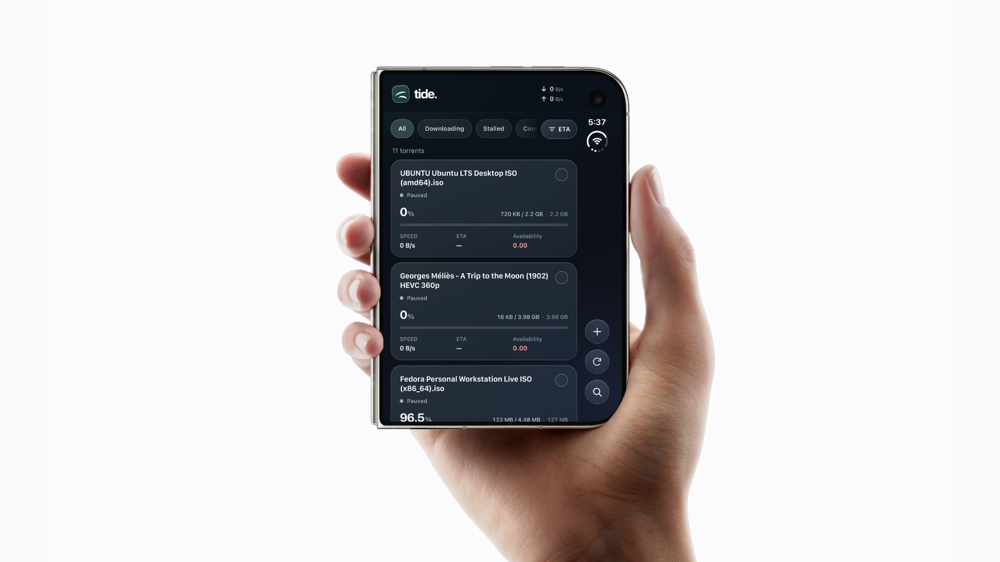
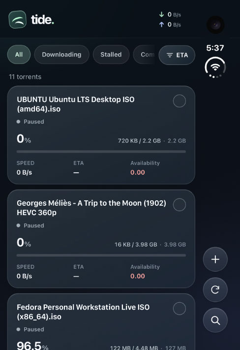
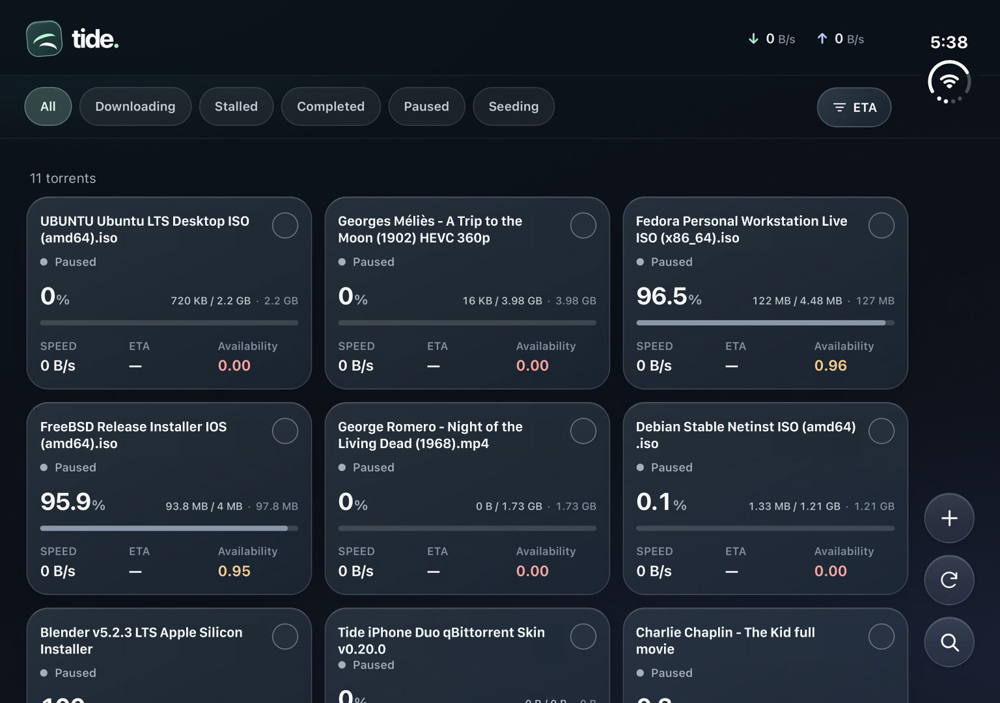

  

<h1 align="center">tide.</h1>

  A touch-first alternative WebUI for <a href="https://www.qbittorrent.org/">qBittorrent</a>, designed for the <strong>iPhone Duo</strong> and compatible with desktop browsers.

  

  

Tide is intended to be used as a Progressive Web App (PWA) on iPhone.

## Screenshots

### iPhone Duo

  
  &nbsp;&nbsp;
  

### Desktop

## Features

- **Adaptive layout:** Compact cards and edge controls when the Duo is folded, expanded list and details when unfolded, and multi-column layouts on desktop.
- **Torrent information:** Status, speed, progress, downloaded/remaining/total size, ETA, and availability.
- **Torrent controls:** Add magnet links or `.torrent` files; search, filter, sort, pause, resume, and remove torrents.
- **Bulk actions:** Select multiple torrents to pause, resume, or remove, with confirmation before deletion.
- **File browser:** Browse nested folders and files with individual sizes and progress.

## Installation

### qBittorrent

1. Download the [latest stable release](https://github.com/Joeljoel/tide/releases/latest) (Source code ZIP) and extract it on the computer running qBittorrent.
2. In qBittorrent, open **Tools → Options → Web UI** and enable **Use alternative Web UI**.
3. Set **Files location** to the extracted directory containing both `private/` and `public/`.
4. Apply the settings, open your qBittorrent WebUI address, and sign in with your existing credentials.

### iPhone PWA

1. Open your qBittorrent WebUI address in **Safari** and sign in.
2. Open **Share → Add to Home Screen**.
3. Enable **Open as Web App** if offered, then tap **Add**.
4. Launch Tide from the Home Screen.

For remote access, keep authentication enabled and use HTTPS or a VPN.

## Updating

Replace the Tide files in your configured alternative WebUI directory with the latest repository files, then reload the app. If the PWA shows a cached version, close and reopen it.

Use **Settings → About → Check updates** to check for newer stable versions on `main`. Updates are installed manually.

## Versioning

Tide follows [Semantic Versioning](https://semver.org/): major releases contain breaking changes, minor releases add features (for example `1.1.0`), and patch releases contain compatible fixes (`1.1.1`). Pre-release test builds use version suffixes such as `1.2.0-beta.1`, `1.2.0-beta.2`, and `1.2.0-rc.1` before the stable release.

## What's new in v1.1.0

- A Settings window with **Tide**, **qBittorrent**, and **About** tabs.
- Light, dark and system appearance options, plus qBittorrent preference controls with explicit Save changes.
- Version checking that understands SemVer, including pre-releases and stable versions.
- Unfolded Duo portrait Settings access in the bottom action row between Add and Refresh, with the original header Settings button in other layouts.
- Light-mode contrast improvements and clearance around iPhone Duo system indicators.

## Unfolded portrait Settings access

In unfolded portrait the Settings gear sits inside the bottom floating action row, directly **between Add and Refresh**. It uses the existing Settings action in the same touchable button rail as the other working controls. In selection/detail views Settings stays available within the contextual action row. The original header Settings gear is shown in folded, landscape and desktop views, and is hidden in unfolded portrait. No standalone floating Settings button or diagnostic overlay is used.
