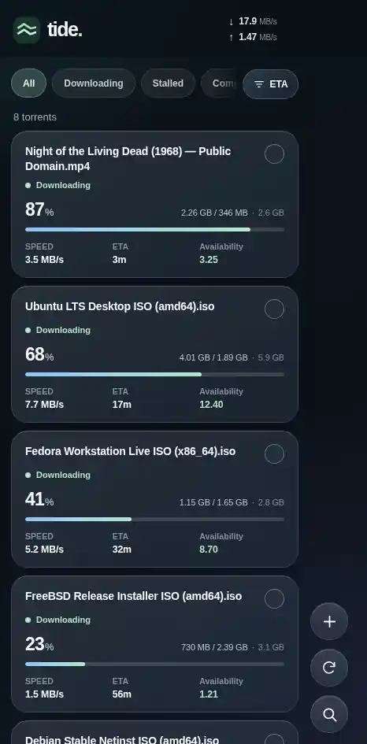
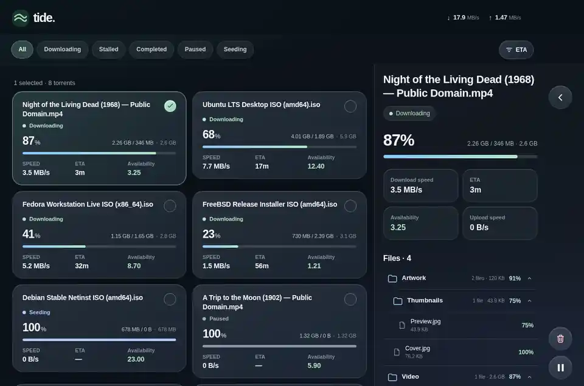
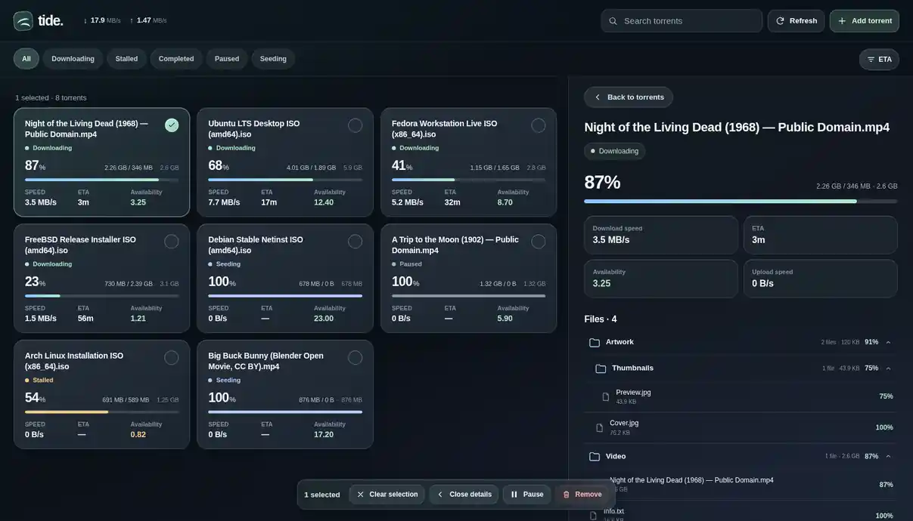

<p align="center">
  
</p>

<h1 align="center">Tide</h1>

<p align="center">
  A minimal, touch-first alternative WebUI for <a href="https://www.qbittorrent.org/">qBittorrent</a>.<br>
  Designed especially for the <strong>iPhone Duo</strong>, while remaining practical on desktop.
</p>

<p align="center">
  
  
  
</p>

## Overview

Tide makes it easy to check and control torrents remotely without a desktop-style table or crowded torrent cards. It prioritises the information you use most: **name, status, speed, completed/remaining/total size, progress, ETA, and availability**.

Tide is an **alternative qBittorrent WebUI**, not a separate torrent client. It communicates with your existing qBittorrent Web API and is intended to be installed as a **Progressive Web App (PWA)** on iPhone.

## Screenshots

### iPhone Duo — folded

<p align="center"></p>

### iPhone Duo — unfolded landscape



### Desktop



<sub>All screenshots use **simulated example data**, including Linux/FreeBSD ISOs, public-domain films and an openly licensed Blender movie. They are browser-rendered layout previews, not captures of a live torrent library or the physical Duo.</sub>

## Features

- **Built for iPhone Duo:** Compact cards and a contextual right-edge control rail on the folded screen; expanded layouts when unfolded.
- **Desktop-friendly:** Full-width filters, mouse-friendly toolbar, multi-column cards and an animated Details panel.
- **At-a-glance torrent health:** Progress, completed/remaining/total size, speeds, ETA, status and **availability**.
- **Fast management:** Add magnet links or `.torrent` files; search, filter, sort, refresh, pause, resume and remove torrents.
- **Bulk selection:** Select multiple torrents and apply pause, resume or removal to the selection, with delete confirmation.
- **Folder-aware Details:** Browse expandable, nested torrent folders with file counts, sizes and progress.
- **About Tide:** Tap the logo for the installed version, qBittorrent session and lifetime transfer totals, GitHub update status and **Sign Out**.
- **PWA-ready:** Home Screen installation, touch controls, safe-area awareness and responsive layouts.

## Install

### 1. Enable Tide in qBittorrent

1. Download the [repository ZIP](https://github.com/Joeljoel/tide/archive/refs/heads/main.zip) and extract it on the machine running qBittorrent. The **root folder** must contain `private/` and `public/` (do not select `private/` by itself).
2. Open qBittorrent and navigate to **Tools → Options → Web UI** (or **Tools → Preferences → Web UI** on some platforms).
3. Enable **Use alternative Web UI** and set **Files location** to that extracted root folder.
4. Apply the setting and refresh your qBittorrent WebUI page. Sign in using your existing qBittorrent credentials.

> **Tip:** Keep a backup of your previous alternative WebUI. qBittorrent's Web UI settings let you return to it if needed.

### 2. Install Tide as a PWA on iPhone Duo

1. Open your **qBittorrent WebUI address** in **Safari** on the Duo. Use your usual secured remote URL when outside your local network.
2. Sign in, then open Safari's **Share** menu.
3. Select **Add to Home Screen**, enable **Open as Web App** if offered, and tap **Add**.
4. Launch **Tide** from the Home Screen. It will adapt as the Duo is folded or unfolded.

The browser view works without installing the PWA, although the standalone Home Screen experience is the primary mobile target. On a desktop browser, open your normal WebUI URL.

> **Security:** Keep qBittorrent authentication enabled. For remote access, prefer HTTPS behind a secured reverse proxy or a VPN; don't expose an unauthenticated WebUI to the internet.

## Updating

Replace the Tide files in your configured alternative WebUI folder with newer repository files and reload the app. For caching problems, fully close and reopen the PWA.

Tap **Tide logo → Check updates** to compare the installed version with [`version.json`](version.json) on `main`. Tide does not update itself automatically.

## Compatibility & limitations

- Requires qBittorrent with support for alternative WebUIs and its Web API.
- The iPhone Duo layout is still being refined. **Unfolded portrait may show an inaccessible bottom strip** due to the current standalone WebKit viewport behaviour. Folded and unfolded landscape are the main design targets at present.
- Liquid Glass styling is a web approximation of Apple's system appearance.
- This is an **early-development** project; please test changes before relying on them as your only management interface.

## Project structure

```text
private/            Authenticated UI, CSS, JavaScript, icons, manifest
public/             qBittorrent sign-in page
screenshots/        Simulated folded Duo, landscape Duo, desktop previews
version.json        Published build version for in-app update checks
```

Tide is an independent community project and is not affiliated with Apple or the qBittorrent team.
